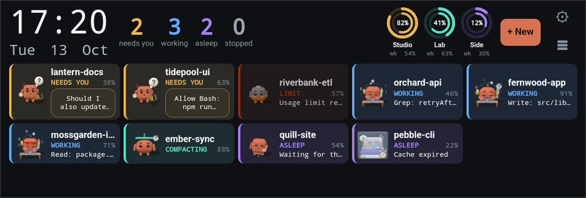
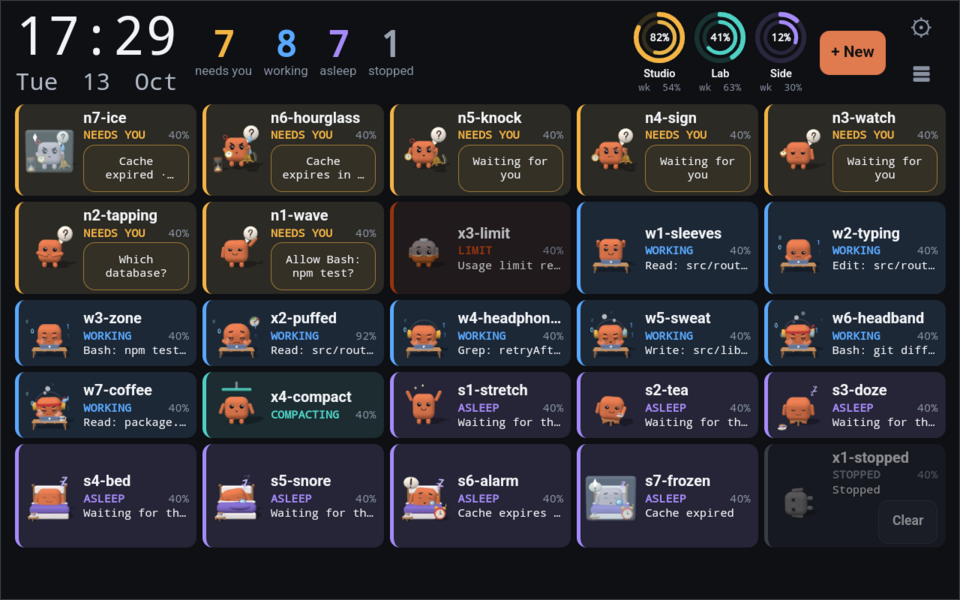
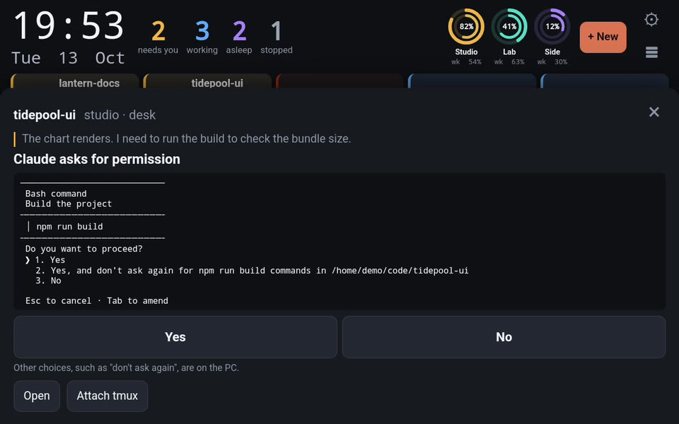
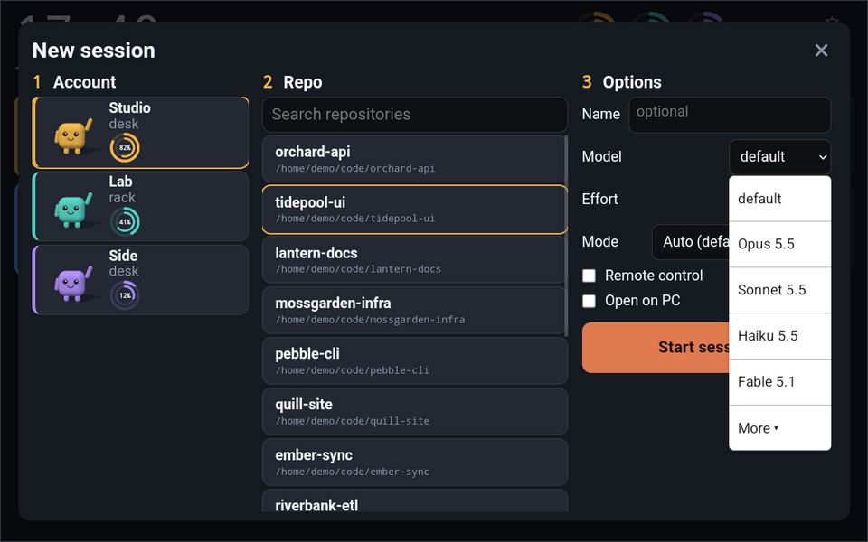
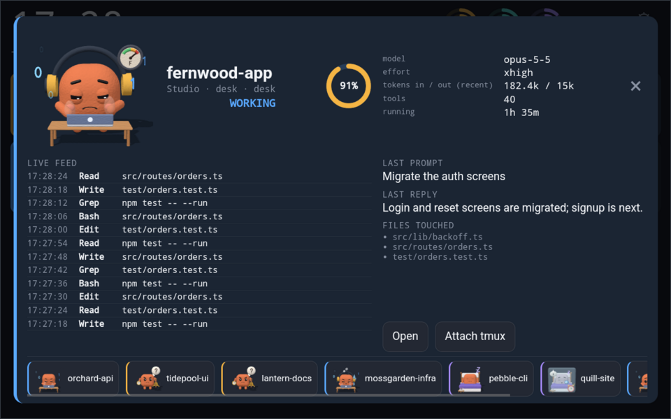
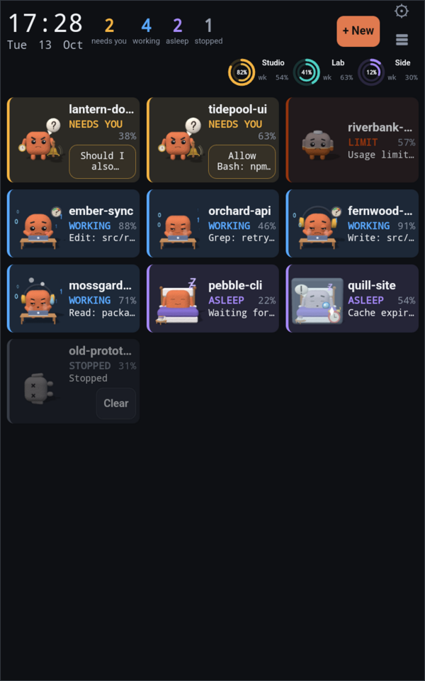
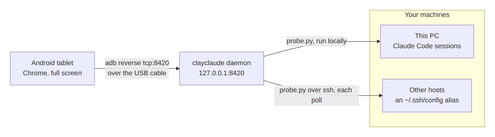

<div align="center">

<picture>
  <source media="(prefers-color-scheme: dark)" srcset="docs/media/banner-dark.png">
  
</picture>

<h1>clayclaude</h1>

<b>Every Claude Code session on your machines, live on a spare Android tablet, as animated clay characters.</b><br>
Because the session that is waiting on you is never the terminal you are looking at.

<a href="LICENSE"></a>


<a href="#try-it-in-30-seconds">Try the demo</a> · <a href="#how-it-works">How it works</a> · <a href="#install-and-set-up">Install</a> · <a href="#configuration">Configuration</a> · <a href="#security">Security</a> · <a href="#troubleshooting-and-faq">FAQ</a> · <a href="CHANGELOG.md">Changelog</a>

</div>

<br>

<picture>
  <source srcset="docs/media/board.gif" type="image/gif">
  
</picture>

> **One glance tells you which session is waiting on you, and you can answer it from the tablet.**<br>
> 26 animated states · no agent to install on the hosts it watches · listens on `127.0.0.1` only.

## Try it in 30 seconds

The demo runs a board of simulated sessions. It needs no hosts and no credentials, and nothing is run when you tap.

```sh
git clone https://github.com/jonathanavis96/clayclaude.git
cd clayclaude
npm i && npm run build
node dist/cli.js demo      # then open http://127.0.0.1:8421
```

Add `--adb` to show it on a plugged-in tablet as well. All the demo's options are under [Demo mode](#demo-mode).

For your real sessions: `node dist/cli.js setup`, then `node dist/cli.js serve`, then plug the tablet in. The details are under [Install and set up](#install-and-set-up).

### Or tell your agent

> Read README.md in github.com/jonathanavis96/clayclaude, run its demo, then walk me through `clayclaude setup` one step at a time and show me every change before you make it.

## What you see

clayclaude watches every Claude Code session on this machine and on any machine you can reach over ssh. It shows each one as a card or row with a clay character, its context use, the time in its state and the prompt-cache countdown. Above them sit the clock, the counts, and each account's five-hour and weekly usage meters.



| State | When it changes | What the character does |
|---|---|---|
| **Needs you** (N1 to N7) | At 1, 5, 10 and 30 minutes. N6 starts 5 minutes before the prompt cache expires, N7 when it has | Waves under a question bubble, then gets impatient: a watch, a bell, an hourglass, and finally frozen in ice |
| **Working** (W1 to W7) | At 1, 5, 15, 30, 60 and 120 minutes | Types at a desk, then puts on headphones, sweats, ties on a headband and reaches for coffee |
| **Asleep** (S1 to S7) | Same timings as Needs you | Stretches, sips tea, dozes, then sleeps in bed; an alarm clock as the cache runs out, frozen when it has |
| **Stopped** (X1) | The session has stopped | Lies grey on its side, with crossed-out eyes |
| **Context nearly full** (X2) | At 85 % context or more | Puffs up, with a gauge |
| **At the usage limit** (X3) | The account has hit its usage limit | Turns grey and glum |
| **Compacting** (X4) | Claude is compacting the conversation | Squashed under a press |

Claude Code's transcripts do not record a 1M context window, so set `contextWindows` in the config for models whose sessions run on 1M (see [`example.config.yaml`](example.config.yaml)). Otherwise the board assumes 200k until it sees a session go past it.

L1, a waving character in each account's colour, marks the accounts in **+ New**.

## What you can do from the tablet

<table>
<tr>
<td width="50%">
<picture>
  <source srcset="docs/media/answer.gif" type="image/gif">
  
</picture>
<br><b>Answer a waiting prompt.</b> Tap the question, then Yes or No.
</td>
<td width="50%">

<br><b>Start a new session.</b> Account, repository, then model, effort and mode.
</td>
</tr>
<tr>
<td width="50%">

<br><b>Focus on one session.</b> Live tool feed, last prompt and reply, files touched.
</td>
<td width="50%" align="center">

<br><b>Portrait works too.</b> The header wraps and the grid reflows.
</td>
</tr>
</table>

You can also open a session in Chrome or the Claude desktop app, attach to its tmux pane on the PC, give it a board nickname, and clear stopped sessions.

## How it works

<picture>
  <source media="(prefers-color-scheme: dark)" srcset="docs/media/how-it-works-dark.png">
  
</picture>

In words: the daemon runs a small Python probe on this PC and, over ssh, on each other host. It serves the board to the tablet through `adb reverse` on the USB cable.

- **Optional hooks** append events to `events.jsonl`, so the board can tell "needs you" from "finished".
- **Answers** are typed into the session's tmux pane, and only if the prompt on screen is still the one you saw.
- **+ New** opens a tmux window. The tablet never sends a command line; the daemon checks every choice first.
- **Off the cable**, nothing listens on your network unless you turn LAN mode on.

## Install and set up

| You need | Where | Notes |
|---|---|---|
| **Node.js 22** or later | The machine that runs the daemon | |
| **Python 3.8+** | Every host you watch, this one included | The probe is one script streamed over ssh on each poll |
| **ssh** with key login | Remote hosts, by a `~/.ssh/config` alias | clayclaude uses `BatchMode=yes`, so it never asks for a password |
| **tmux** | A host, to answer prompts and start sessions there | Sessions outside tmux are still shown; they only get **Open** |
| **adb** (Android platform tools) | The machine that runs the daemon | Under WSL, use the Windows `adb.exe` |
| **Any Android tablet** | | USB debugging turned on, and Chrome |
| **scrcpy** and **AutoHotkey v2** | Windows, optional | For the [hotkey](#the-hotkey-windows) |
| **Chromium or Chrome** | The daemon's machine, optional | A fallback that bakes characters on the PC for a weak tablet |

**Install.** From a clone:

```sh
git clone https://github.com/jonathanavis96/clayclaude.git
cd clayclaude
npm i
npm run build
```

Once the package is published, `npm i -g clayclaude` will do the same. In a clone, run `node dist/cli.js <command>` wherever this README says `clayclaude <command>`.

**Set up and run.**

```sh
clayclaude setup      # find your accounts, write the config, set up the tablet
clayclaude serve      # run the daemon
```

Plug the tablet in. The board opens on it by itself.

```text
clayclaude serve [--config <path>]
clayclaude setup [--config <path>]
clayclaude demo  [--port N (default 8421)] [--scenario board|gallery] [--speed N] [--sessions N] [--adb] [--kiosk]
```

`--config` defaults to `~/.config/clayclaude/config.yaml`. Run `clayclaude` with no command for this list.

<details>
<summary><b>What <code>clayclaude setup</code> does, step by step</b></summary>

`clayclaude setup` asks before it changes anything, and each step can be skipped. It:

1. Asks which ssh hosts (from your `~/.ssh/config`) also run Claude Code. For each host it asks for the tmux session that new sessions go in, and the folders that hold your repos.
2. Finds every Claude config directory (`~/.claude`, `~/.claude-work`, ...) on this machine and on those hosts. For each one it asks whether to add it, its label and colour, where its usage figures come from, and what **Open** should do (offering the Chrome profiles it finds).
3. Offers to install the hooks into that account's `settings.json`. It shows the exact diff first, saves a backup (`settings.json.bak-clayclaude-<time>`) before writing, and leaves every other setting and hook as it was.
4. Offers to set up the tablet over adb (see [The tablet](#the-tablet)).
5. Under WSL, offers to install the hotkey script (it runs on the Windows side).
6. Offers LAN access (off by default) and generates its token.
7. Writes the config with mode 0600. An existing config is kept as `config.yaml.bak-<time>`.

Re-running setup starts from scratch and writes a new config (the old one is kept as a backup), so copy any hand edits across.

</details>

<details>
<summary><b>The hooks</b></summary>

The hooks are optional but recommended. They let the board tell a session that **needs you** (a permission prompt or question) from one that has simply **finished** its turn, and show compaction as it happens.

They add one line per event (`Notification`, `Stop`, `PreCompact`, `SessionStart`, `SessionEnd`) that runs `<config dir>/clayclaude/hook.py`. The script appends the event to `<config dir>/clayclaude/events.jsonl` (mode 0600), never prints, and always exits 0, so it cannot block or break a session.

The command finds the account's directory through `CLAUDE_CONFIG_DIR` (or `~/.claude` when it is unset). So several accounts can share one `settings.json`, symlinked or generated from one file, and each still logs to its own `events.jsonl`.

</details>

## Platforms

| Platform | Status |
|---|---|
| Windows through WSL2 | Tested setup. Claude Code, tmux and clayclaude run inside WSL. `adb.exe`, Windows Terminal, Chrome or the Claude desktop app, and the hotkey run on the Windows side |
| Linux | Supported |
| macOS | Not tested |
| Native Windows as a host | Not supported. The probe refuses to run there, because its process check would send Ctrl+C to the sessions it watches. The daemon logs why and shows it as the reason that host cannot launch |
| Tablet | Any Android with USB debugging and Chrome |
| Hotkey | Windows only (scrcpy and AutoHotkey v2) |

## Using the board

One row or card per session, most urgent first. Tap a count to filter, tap a row for its focus view, and tap **Answer** on a session that needs you. **+ New** starts a session, and **⚙** holds the settings. Double-tap the clock or blank space to enter or leave full screen. Each part is described below.

<details>
<summary><b>The board</b></summary>

One row per session, most urgent first: needs you, at the usage limit, working, compacting, asleep, stopped. Within that, the longest-waiting needs-you session comes first, otherwise the most recent change. Each row shows the session's character, name, account and host, what it is doing or asking, its context use, the time in that state and the prompt-cache countdown.

The top bar holds the clock and date, the needs-you, working, asleep and stopped counts, each account's usage meters, **+ New** and **⚙** settings. Tap a count to show only those sessions; tap it again, the clock or blank space to show all. Double-tap the clock or blank space to enter or leave full screen.

A needs-you row has an **Answer** button (or **Open**, for a session that is not in tmux but has a remote-control link), and an asleep row in tmux has **Message**. Tap anywhere else on a row for its focus view.

A stopped row has **Clear**, and the stopped filter has **Clear all stopped**. A cleared session stays hidden (kept in `~/.config/clayclaude/state.json`, beside the config). Its registry file is removed only when the host confirms, at that moment, that its process is dead and the file sits in that account's `sessions/` folder. Running sessions are never touched.

</details>

<details>
<summary><b>Renaming</b></summary>

Long-press a session's name (or right-click it with a mouse) to give it a board nickname of up to 40 characters. This works on the board, in its focus view's title, or in an account's session list. **Save** (or Enter) keeps it; **Reset** goes back to the session's own name, which stays in the name's tooltip.

The nickname is the board's alone: nothing is typed into the session, and Claude's own session name does not change. For a running session in tmux the sheet also offers two ticks, both off by default:

- **Also rename the tmux window** runs `tmux rename-window` on the session's host and nothing else. tmux cannot take a name with `#` or `\`, or one ending in `;`.
- **Also rename in Claude Code** types Claude Code's own `/rename <name>` command into the session, which renames it as Claude Code shows it (its input box, `/resume` and the terminal title). It runs no model turn. It is typed only under the same three checks as **Message**: Claude Code reports the session idle, its pane shows Claude's empty input box, and the pane is still that session's. It goes in as one checked bracketed paste. Enter is pressed only if the screen then shows exactly that command in the box and nothing new above it. If any check fails, nothing is renamed, not even on the board, and the sheet says why. **Reset** changes nothing in Claude Code. A session that has never had a prompt shows a hint in its input box that cannot be told from typed text, so it is refused until its first prompt.

Nicknames are kept in the same `state.json` and go when the session is cleared. A **Name** given in **+ New** is passed to Claude as `--name` and becomes the session's name on the board.

</details>

<details>
<summary><b>Characters and animation modes</b></summary>

Every session has a clay character whose animation follows its state and how long it has been in it, 26 states in all (see [What you see](#what-you-see)). `/gallery` on the daemon or the demo shows every state at once.

Characters are drawn live in 3D on the tablet, baked into frames on the tablet, or baked on the PC and sent over. **Animation mode** in settings picks one. **Auto** (the default) tries them on the device: live 3D if it holds 55 fps with no frame over 50 ms, otherwise baking on the tablet, otherwise baking on the PC. It remembers the result until the renderer changes, and a mode that fails for a state falls back to another.

</details>

<details>
<summary><b>Grid view</b></summary>

When the rows would not fit the screen, the board switches to a grid of smaller cards, and back when there is room again. **Layout** in settings fixes it to rows (**Strips**) or **Grid** instead.

</details>

<details>
<summary><b>Focus view</b></summary>

Tapping a row or card opens a large character with the session's context ring, model, effort, recent token counts, tool count and running time. Below are a live feed of its tool calls, the last prompt and reply, and the files touched. **Answer**, **Message**, **Open** and **Attach tmux** appear where they apply. Small characters for the other sessions run along the bottom, to switch to them. Back or **×** closes it.

</details>

<details>
<summary><b>The answer sheet</b></summary>

**Answer** on a session that needs you reads its tmux pane and shows the question as it stands. A permission prompt (Claude asking to run a command, edit a file, use a tool or start on a plan) is shown with the whole screen exactly as the terminal draws it, and two buttons: **Yes** (allow once) and **No**. Yes is offered only when Claude's own first option is a plain "Yes"; approving a plan also changes the session's permission mode, so a plan gets **No** only and is approved on the PC. Other choices, such as "don't ask again", are made on the PC; the sheet offers **Open** and **Attach tmux** for that. A question menu shows its numbered choices as buttons, and a free-text question gets a reply box and the quick-reply buttons (`ui.quickReplies`).

Each answer is sent by one script on the session's host that first checks the screen is still the one you saw (for a reply, Claude's input box and the rows under it, since the spinner above it never holds still; Claude's blinking tool bullet is ignored; the host needs `sha256sum`, `shasum` or `openssl`); if it has changed, nothing is sent and the sheet shows the new prompt. A reply arrives as a single bracketed paste, which a permission prompt ignores, and its Enter is pressed only if Claude's input box still looks the same after it. A permission prompt itself is only ever answered by your own tap: **Yes** types `1` and **No** presses Escape.

A reply sent while Claude is still working is queued, just like typing it at the PC: Claude Code holds it and the model reads it at its next pause. This leaves one rare gap, accepted on purpose: if Claude opens a permission prompt in the same few tens of milliseconds as the reply's Enter, the Enter can land on that prompt (Claude Code moves the keyboard to a new prompt before it draws it) and pick its highlighted option. On a tool's permission prompt that is "Yes" (allow this call once). On a plan approval, which Claude opens mid-turn, it is "Yes, and use auto mode": the plan is approved and the session's permission mode switches to auto. To rule it out, wait for Claude to finish before replying from the tablet. The same window applies when a prompt is answered at the PC at the same instant as a Yes or No tap on the tablet: the tablet's key can then land on the next prompt Claude opens, and Yes types 1, which on a plan approval is "Yes, and use auto mode". To rule that out, answer a prompt in one place only.

Claude's startup questions (folder trust, external `CLAUDE.md` imports) are answered from the sheet only for a launch from **+ New** that is still starting. If the answer leads to another question, the sheet shows it; if the session has not moved on 10 seconds after an answer, the sheet offers **Open** and **Attach tmux** on the PC. **Confirm before sending** (`ui.confirmBeforeSend`) asks once more before each answer.

**Message** on an asleep session (one that finished its turn) opens the same reply box and quick replies, to give it its next prompt. The text is typed, with Enter, only when three checks all pass: Claude Code itself reports the session idle (its last hook event is Stop, or without hooks its registry says idle; never with a permission or question pending, or while it works or starts), its pane shows Claude's empty input box at the bottom with nothing under it, and the pane is still that session's, in the foreground and not in copy mode or synchronize-panes. If any check fails, nothing is sent and the sheet says why. The text goes in as one bracketed paste by the same checked script as a reply, and is refused if the screen changed since it was read.

</details>

<details>
<summary><b>+ New</b></summary>

The launcher has three steps. Pick an account (each shows its usage rings; one whose host cannot launch says why). Search for a repository under that host's `repoRoots`. Then choose the model, effort and mode, and tick **Remote control** (when the host's `claude` supports `--remote-control`) or **Open on PC** (also attach a terminal on the PC to the new window). **Start session** runs it; see [Launching new sessions](#launching-new-sessions).

</details>

<details>
<summary><b>Settings (⚙)</b></summary>

Settings are kept on each device, in its browser:

- *Characters*: animation mode (and which one Auto chose, and why), shadows, a frame-rate cap and the body colour.
- *Board*: layout (Auto, Strips, Grid), usage shown as rings or bars, how long stopped sessions stay, and a chime when a session needs you (off by default). **Show background sessions** (off by default) also lists headless helpers such as `claude -p` and Agent SDK processes, which the board otherwise hides.
- *Night dimming*: dim the board between two times, and how much.
- *Answering*: confirm before sending, and the quick replies, overriding the config's `ui` defaults on this device.
- *Accounts and hosts*: what the config holds, read only.

</details>

## The tablet

**One-time setup.** Turn on Developer options and USB debugging on the tablet, plug it in, and accept the "Allow USB debugging" prompt. `clayclaude setup` then offers to run these, showing each adb command first:

- `adb reverse tcp:8420 tcp:8420`, so `http://localhost:8420` on the tablet reaches the daemon over the cable;
- a 30-minute screen timeout;
- auto-rotate off and the screen locked to landscape;
- opening the board in Chrome;
- keeping the screen on while the tablet is charging.

It then explains how to install the board as an app from Chrome's menu, if the tablet's home screen allows that, and can check whether it is installed.

While `clayclaude serve` runs, it checks every 3 seconds that the reverse is in place on each connected device and re-applies it. So unplugging and replugging the cable recovers by itself. If the daemon cannot be reached, the board keeps the last state and shows "Disconnected · retrying" until it can.

<details>
<summary><b>Kiosk by default</b> (<code>tablet.kiosk: true</code>)</summary>

When the tablet is plugged in, the board opens full screen by itself: no install step and no tap.

The tablet connects when it is plugged in, when the daemon starts with it plugged in, or when its reverse had to be applied again. Each time, the daemon wakes the screen, keeps it on while charging, and opens the board. It opens the installed app if there is one, otherwise Chrome, with a "Tap to start" cover over the page and one tap injected over adb to go full screen.

Afterwards a reload, a tab switch, Back, a swipe or a rotation can leave that board showing but not full screen. It then asks the daemon for the tap again, so it goes back to full screen by itself. Taps are kept at least 3 seconds apart and stop after 8 in two minutes.

Only the page the kiosk opened can ask. Its address carries a random key, new each time the daemon starts, so a board opened any other way (a desktop browser, or a page some website opened) never makes the daemon tap the tablet.

It never taps while the lock screen is showing (a swipe lock is dismissed; a PIN is not). Unlock the tablet, and the board asks for its tap when it is back in front.

Press **Home** to leave the board; the next replug opens it again. Each launch is logged in the daemon's output, and a launch that fails is not retried until the next connect. With `tablet.serial` set, only that device gets the kiosk; set `tablet.kiosk: false` to turn it off.

</details>

<details>
<summary><b>Full screen by hand: double-tap</b></summary>

If the board is showing in an ordinary Chrome tab, double-tap the clock (or any blank space on the board): the board fills the screen, and it follows the tablet's rotation. Double-tap again to leave full screen. Chrome only allows either after a tap, so after leaving full screen another double-tap goes back in.

A board opened by the kiosk stays out of full screen after a double-tap exit until it is reloaded or the tablet is rotated. A single tap on the clock or blank space clears a count filter.

With a sheet or the focus view open in full screen, the first Back leaves full screen (Chrome handles it before the page) and the next Back closes the sheet. A board opened by the kiosk waits for the sheet to close before it goes back to full screen.

If Chrome offers "Install app" or "Add to Home screen" for the board, installing it gives a full-screen app with no browser bars. Some tablets' launchers do not allow it; the board works the same either way.

</details>

## Configuration

The config lives at `~/.config/clayclaude/config.yaml`. `setup` writes it, and [`example.config.yaml`](example.config.yaml) shows every key with comments. The main parts are below.

> **Run only one refresher per account.** Refresh tokens rotate. If clayclaude and another program (a usage dashboard, a publisher script) both refresh the same account's token, one of them ends up holding a dead token and that login breaks.
>
> If anything else refreshes an account, either read its figures with `provider: http`, or keep `oauth` and turn refreshing off:
>
> ```yaml
> usage: { provider: oauth, refresh: false }
> ```
>
> clayclaude then only reads the credentials file and never writes it; an expired token shows a "stale" meter until the other program refreshes it. `setup` asks about this for every `oauth` account.

<details>
<summary><b>Hosts and <code>repoRoots</code></b></summary>

```yaml
hosts:
  - id: local                 # this machine
  - id: build-box
    ssh: build-box            # an ssh config alias
    tmuxSession: agents       # where "+ New" creates windows
    repoRoots: [~/code]       # where the launcher looks for repos
```

`repoRoots` lists the folders that hold your repositories on that host (`~` is that host's home folder). Setup asks for them, for this machine and for each ssh host, with `~/code` as the default.

**+ New** offers every git repository (a folder with `.git` inside) one or two levels below a root: so `~/code/app` and `~/code/clients/site`, but nothing deeper and not the root itself. Hidden folders and `node_modules` are skipped, symlinked folders are not followed, and a repository's subfolders are not searched. A root that does not exist is ignored, and the list stops at 400 repositories.

**Repos on the Windows drive.** Under WSL, add the Windows folder by its `/mnt` path as a root, for example `/mnt/c/Users/<you>/source/repos`. It works, but listing and working in it is slower than on the Linux filesystem.

Keys, jump hosts and ports stay in your `~/.ssh/config`. A host that stops answering keeps its sessions on the board, greyed and tagged "host offline · last seen N min ago", and is retried with backoff.

</details>

<details>
<summary><b>Accounts</b></summary>

One per Claude config directory on a host:

```yaml
accounts:
  - id: personal
    label: Personal
    colour: "#e8b54a"
    host: local
    configDir: ~/.claude
    usage: { provider: oauth }
    open: { type: app }
```

</details>

<details>
<summary><b>Usage meters: <code>oauth</code>, <code>http</code>, <code>token</code>, <code>meter-log</code>, <code>none</code></b></summary>

**Which one do I pick?** A normal `claude` login (a `.credentials.json` in the config dir): `oauth`. A `claude setup-token` token: `token`, or `meter-log` if a usage meter already runs for that account (no extra calls). Figures another tool already serves over HTTP: `http`.

Each account's meter shows the five-hour and weekly windows. `usage.provider` is one of:

- `oauth` (default): reads `<configDir>/.credentials.json` on the account's host and asks Anthropic for the figures. The request runs on that host, through the probe. When the access token is within five minutes of expiring (or the API answers 401), clayclaude refreshes it. It writes the new token back atomically, after copying the old file to `.credentials.json.bak`.
- `http`: reads the figures from a URL another tool already publishes: `usage: { provider: http, url: "http://localhost:8790/usage", key: work }`. The URL must return `{ "<key>": { "five_hour": { "utilization": 42, "resets_at": "..." }, "seven_day": { ... } } }`.
- `token`: for an account whose only credential is a long-lived `claude setup-token` token (the usage endpoint refuses those): `usage: { provider: token, tokenEnv: MY_CLAUDE_TOKEN, envFile: ~/.config/me/env }`.
  - The probe reads the variable on the account's host, from its environment first, else from the one `MY_CLAUDE_TOKEN=...` line of `envFile` (the file is parsed, never run).
  - It sends one `max_tokens: 1` message to a small Haiku model and reads the five-hour and seven-day meters off the reply's `anthropic-ratelimit-unified-5h-*` / `-7d-*` headers.
  - The token stays on that host: it never reaches the daemon, its log, `/api/state` or an error message.
  - Each call spends a little of the account's usage, so it runs at most once every 5 minutes per account. None run while the week is at 100 %.
  - None run after the five-hour window has run out, until a `claude` run on that account starts a new one. A call would otherwise start the window itself.
  - Optional `model:` picks another model id.
- `meter-log`: reads the newest line of a usage meter's JSON-lines log on the account's host, so clayclaude makes no API calls of its own: `usage: { provider: meter-log, log: ~/ops/claude-usage-meter-me.log }`.
  - Each line looks like `{"ts": "...", "five_hour": {"utilization": 0-100, "resets_at": "..."}, "seven_day": {...}}`. Only the end of the file is read, and error or half-written lines are skipped.
  - A reading older than 15 minutes shows as stale, unless the account has been idle since the reading's five-hour reset. Idle means no `claude` run has touched `<configDir>/sessions` since then, so the meter rightly takes no new reading. That exception ends at the reading's own weekly reset.
  - An account in use with an old reading means the meter has stopped writing, so it shows stale.
- `none`: hides the meter.

`envFile` and `log` are absolute paths or `~/...` (that host's home). They travel to the host as data inside the probe's request, never through a shell.

The daemon serves the merged figures at `GET /usage` in the same shape, so an existing dashboard can read from clayclaude instead of running its own refresher.

</details>

<details>
<summary><b>Open actions and Attach</b></summary>

`open.type` sets what **Open** does for an account's sessions:

- `chrome`: opens the session's remote-control page (`https://claude.ai/code/<id>`) in a Chrome profile: `open: { type: chrome, profileDirectory: "Profile 2", incognito: false }`. The Chrome binary comes from `browsers.chrome`, which setup fills in.
- `app`: opens the session in the Claude desktop app through `appLink` (default `claude://code/{id}`). Set `appLink: "https://claude.ai/code/{id}"` to use your default browser instead. The `claude://` link is read from the app's own link handler and can change between app versions; if Open starts the app without showing the session, use the browser link.
- `tmux` (default): **Open** attaches to the session's tmux pane in a terminal, the same as **Attach**.

**Attach** (any session in tmux) opens a terminal on this machine attached to the session's pane, over ssh for a remote host. That is Windows Terminal by default (`terminal: { type: wt }`), or any terminal through `terminal: { type: template, template: [...] }`. Sessions without a remote-control link only get **Attach**.

</details>

### Launching new sessions

**+ New** on the board starts Claude Code in a new window of the host's `tmuxSession`, in a repo found under its `repoRoots`. It uses that account's config directory and your choice of model, effort and permission mode. Options the host's installed `claude` does not support are hidden. The tablet never sends a command line: the daemon checks every choice against the config and the host before it runs anything.

- **Model.** The list is each account's own. The probe asks the models API (`GET /v1/models`) on the account's host, with that account's OAuth token or setup token.
  - The token is read there and sent nowhere but `api.anthropic.com`. There are no redirects; a token is never refreshed for this, and an expired one is not sent.
  - The list is kept for 24 hours (in memory and `state.json`) and refreshed when the launcher opens. If that fails, the last good list is offered, and failing that a built-in one.
  - The select shows the newest model of each family first (Opus, Sonnet, Haiku, Fable), then **More ▾** with the others.
  - `launch.models` adds extra ids (for example `claude-opus-5-5[1m]`; the aliases `opus`, `sonnet`, `haiku` and `fable` are still accepted). The daemon starts only an id in that account's list, the built-in list or `launch.models`.
- **Mode** (`--permission-mode`), from the choices the host's `claude --help` lists: Manual (no flag), Accept edits, Auto, Plan and Don't ask.
  - `launch.defaultMode` (`manual`, `acceptEdits`, `auto`, `plan`, `dontAsk` or `bypassPermissions`; **`auto` unless set**) is preselected and labelled "(default)". A Start that keeps it passes it as `--permission-mode`.
  - A host whose `claude` does not list that mode gets Manual as its default.
- **Bypass permissions** lets Claude run every tool and shell command without asking. It is offered only with `launch.allowBypassPermissions: true` (off by default). It shows in the warning colour with a warning line, and Start stays off until you tick the confirm under it. The daemon refuses it whenever the config does not allow it or the confirm is missing.
  - If you set `launch.defaultMode: bypassPermissions` (which needs `allowBypassPermissions: true`, or the config does not load), a Start that keeps that default needs no confirm; the warning line still shows. Bypass picked by hand still needs the confirm.
  - **Anyone who can use the board could then start such a session**, so leave it off unless your sessions run somewhere sandboxed.

<details>
<summary><b>LAN mode</b> (off by default)</summary>

Off by default, the daemon listens on `127.0.0.1` only, and the tablet reaches it through `adb reverse`. To open the board from other devices on your network, run `clayclaude setup` and turn LAN access on. That sets:

```yaml
lan:
  enabled: true
  hosts: ["192.168.1.20"]   # the address(es) devices use to reach this machine
  token: "..."              # generated by setup
```

The daemon then listens on every interface. Open `http://<address>:<port>/` on the device and enter the token once. The device keeps a session cookie derived from the token (changing the token signs every device out). Requests from this machine and over `adb reverse` never need the token.

</details>

## Demo mode

```sh
clayclaude demo
```

A board full of simulated sessions moving through every state, with usage meters, on `http://127.0.0.1:8421`. Nothing real is touched: no hosts, no credentials, and tapping Open, Attach, Answer, Message or Start runs nothing. The default port is 8421, one above the daemon's 8420, so the demo runs alongside the daemon.

| Option | What it does |
|---|---|
| `--port N` | Picks another port. The demo stops with "port … is already in use" if it is taken |
| `--scenario gallery` | One session held in each character pose, to see them all at once. `/gallery` on the demo or the daemon shows every pose in a grid |
| `--speed N` | Runs the scenario N times faster (demo minutes per real minute) |
| `--sessions N` | Shows N sessions (1 to 60), repeating the scenario's under numbered names, to see the grid view the board switches to when the strips would not fit |
| `--adb` | Keeps `adb reverse` applied for the demo's port, to show it on the tablet at `http://localhost:<port>` |
| `--kiosk` | As `--adb`, and also opens the demo board full screen on the tablet whenever it connects, the same way `serve` does |

## The hotkey (Windows)

<details>
<summary><b>Win+Shift+T</b>: use your PC's keyboard and mouse on the tablet</summary>

Press **Win+Shift+T** to use your PC's keyboard and mouse on the tablet. It wakes the tablet, brings the board to the front (without reloading it), and starts scrcpy in control-only mode (no video) in a window titled `clayclaude`. It activates and clicks that window, so the mouse moves to the tablet at once. Typing a reply on the tablet then uses your real keyboard.

Press **Win+Shift+T** again, or close scrcpy, to take them back (**Alt**, scrcpy's own shortcut key, also releases the mouse).

Under WSL, `clayclaude setup` writes the AutoHotkey v2 script (`clayclaude-hotkey.ahk`, with the paths to adb and scrcpy filled in; the script itself runs on the Windows side). It can also copy it into your Windows Startup folder. To change the hotkey, re-run setup (in AutoHotkey syntax `#` is Win and `+` is Shift).

</details>

## Security

The board can type answers into your sessions and start new ones, so treat access to it like access to your terminal.

- **Local only by default.** The daemon binds to `127.0.0.1`. The tablet reaches it through `adb reverse` over USB.
- **Loopback is trusted.** Anything that reaches `127.0.0.1:8420` with a `localhost` address needs no token: browsers on this PC (web pages on other sites are refused), and, through `adb reverse`, the tablet. That includes every app installed on the tablet, so use a tablet you control and keep other apps off it.
- **Host and Origin checks** on every request and websocket upgrade. The Host header must be a loopback name (or a configured LAN host), and a page on any other site or port can neither read the board nor send it actions. There are no CORS headers.
- **LAN mode** (off by default) needs the token from `setup` on every request from another device. It is compared in constant time, never logged, and repeated wrong tries lock that address out for a while. The traffic is plain HTTP, so use it only on a network you trust.
- **Never forward LAN traffic to `127.0.0.1`** (for example a `netsh interface portproxy` rule to `127.0.0.1` under WSL). The daemon would see such requests as local, and any client that writes `Host: localhost` would skip the token. Use WSL's mirrored networking, or forward to the WSL address instead.
- **What is read on each host:** Claude Code's session files (`<configDir>/sessions/*.json`), the session transcripts under `<configDir>/projects`, the hook events file, and the process list (to tell live sessions from dead ones). For `oauth` meters and the launcher's model list, also `.credentials.json` and the account email in `.claude.json`. When you open the answer sheet, the session's tmux pane is captured.
- **The only writes:** an `oauth` token refresh (to `.credentials.json`, with a `.bak` copy, and never when `refresh: false`). And the keystrokes of an answer or a message you send, or of a `/rename` you tick in the rename sheet, only if the screen is still the one that was checked, and at most 4,000 characters. Starting a session from **+ New** creates a tmux window when you tap Start. The hooks and the hotkey script are written only by `setup`, after you confirm them.
- **The config** holds no credentials except the LAN token, and is written with mode 0600; `serve` warns if other users can read it. Keep it out of version control.

## Troubleshooting and FAQ

<details>
<summary><b>Does it work without a tablet?</b></summary>

Yes. Open `http://127.0.0.1:8421` in any browser on this PC for the demo, or `http://127.0.0.1:8420` for the daemon. Browsers on this PC reach it without a token.

</details>

<details>
<summary><b>The tablet shows "Disconnected · retrying"</b></summary>

Check the daemon is running, then `adb devices` (the tablet must show as `device`, not `unauthorized`: accept the prompt on the tablet) and `adb reverse --list`. The daemon re-applies the reverse within 3 seconds of the tablet appearing. Under WSL, `tablet.adb` must be the Windows `adb.exe`.

</details>

<details>
<summary><b>The board does not appear, or adb sees no device (WSL)</b></summary>

Only one adb server can hold the tablet. Under WSL the Windows `adb.exe` and a Linux `adb` each start their own server, and the Linux one usually sees no USB device.

To see which one owns it, run `devices` with each: `/mnt/c/Users/<you>/AppData/Local/Android/Sdk/platform-tools/adb.exe devices` and `adb devices`. To switch, set `tablet.adb` in the config to the full path of the one that lists the tablet (`clayclaude setup` does this), and stop the other with `<that adb> kill-server`. Never mix `adb` and `adb.exe`.

The daemon logs the adb it uses at startup and warns if the other one has the tablet.

</details>

<details>
<summary><b>No sessions appear</b></summary>

Check `configDir` points at the directory the sessions use (`CLAUDE_CONFIG_DIR`), and that sessions were started after Claude Code began writing `<configDir>/sessions/`.

</details>

<details>
<summary><b>Sessions finish but never show "needs you"</b></summary>

Install the hooks (`clayclaude setup`).

</details>

<details>
<summary><b>A host shows "host offline"</b></summary>

Check that `ssh <alias> python3 --version` works without a password prompt from the machine running the daemon.

</details>

<details>
<summary><b>A meter shows "stale"</b></summary>

The provider failed or the token expired. With `refresh: false`, the token is refreshed only by the other program; run `claude` in that account once to log in again if both have given up.

</details>

<details>
<summary><b><code>port 8420 is already in use</code></b></summary>

Another clayclaude (or the demo) is running. Stop it, or set `port:` in the config.

</details>

<details>
<summary><b>The tablet cannot connect on Windows + WSL, and <code>adb reverse</code> fails</b></summary>

Hyper-V can reserve a range of ports on Windows, and the range can move on each reboot. `netsh int ipv4 show excludedportrange protocol=tcp` (read only, from a Windows terminal) lists the reserved ranges. Choose a port outside them with `port:` in the config.

</details>

<details>
<summary><b>Characters do not appear on a weak tablet</b></summary>

The board can fall back to characters baked on the PC. That needs a Chromium or Chrome the daemon can find (Playwright's browser cache, or a system install). Point `CLAYCLAUDE_CHROMIUM` at the binary if it is somewhere else.

</details>

<details>
<summary><b><code>clayclaude: no board build in ...</code> (from a clone)</b></summary>

Run `npm run build`.

</details>

## Contributing

- Issues and pull requests are welcome.
- Before a pull request, run `npm run typecheck` and the test files your change touches (`npx vitest run test/<file>`).
- `npm test` runs the whole suite; save it for broad changes.
- Fixtures, screenshots and recordings use demo data only: no real session, host, account or path names.
- Captures in `docs/media` are recorded from `clayclaude demo` on a real tablet.

## Licence

[MIT](LICENSE)
